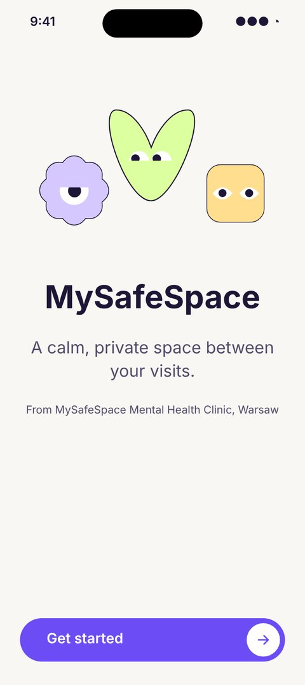
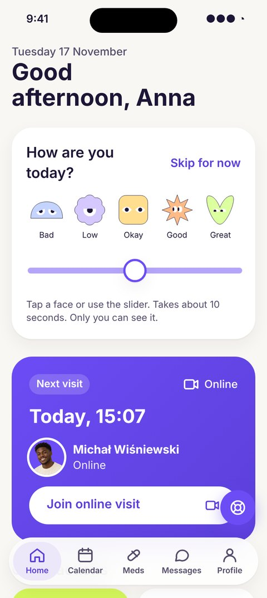
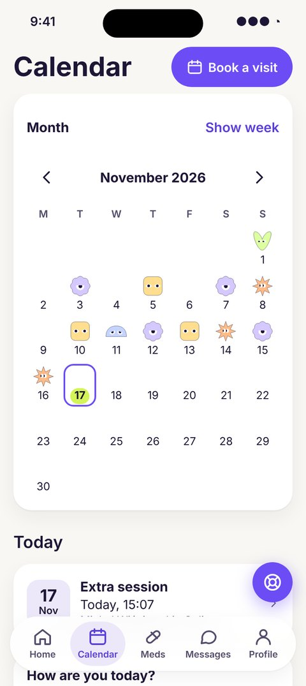
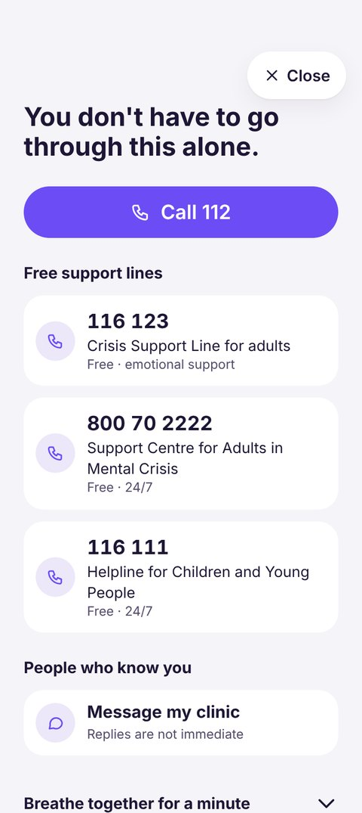

# MySafeSpace; a calm, private space between visits

**Phase 1: iOS patient app** for a Polish outpatient mental health clinic (*poradnia zdrowia psychicznego*). A portfolio build: a fully clickable SwiftUI app on mock data, designed to look and behave like a real, safe, legally aware product, with an architecture the production build can reuse.

*Design & product: Marta Chróstowska · SwiftUI · SwiftData · iOS 26 · no third-party dependencies*

**[▶ Try the clickable prototype in your browser](https://chrostowskamarta-bit.github.io/mysafespace-ios/)** · [Full case study on skandal.studio](https://skandal.studio/works/mysafespace-app)

<p>
  
  
  
  
</p>

---

## The problem

Between weekly sessions, patients are on their own. Three things kept coming up:

1. **"My doctor won't give me her phone number, but I need to reach her."** Clinicians rightly protect their private numbers, and then feel guilty that patients have no way to reach them.
2. **"By Thursday I've forgotten what upset me on Monday."** Sessions start with "So… how was your week?" and the important moments are gone.
3. **"There's nobody to turn to at 11 pm."** Patients need ad-hoc contact and crisis support, without the clinic promising 24/7 monitoring it can't provide.

## Research

12 in-depth interviews across 3 user groups (patients, clinicians, admin staff) shaped the personas, the privacy and safety principles and the core features below. Moderated usability tests with 5 patients: **15/15 tasks completed**, and a prescription renewal took about **10 seconds**.

## Personas

| | Who | Pain | Fear |
|---|---|---|---|
| **Anna, 29** | UX designer, weekly therapy for anxiety | Forgets her week by the session; no way to reach her therapist | "What if someone reads my journal?" |
| **Marek, 52** | Logistics manager, on medication for depression, uses large text | Prescriptions run out; renewing means phoning during work hours; bad days make apps hard | His employer or family finding out |
| **Dr Katarzyna, 41** | Psychiatrist (Phase 2 user) | Won't share her number; no view of how patients do between visits | Missing a patient in trouble |

## Pain points → solutions

| Pain point | What the app does |
|---|---|
| No contact without a private number | **Bounded secure messaging.** Every thread shows "Dr Nowak usually replies within 1 working day · Mon–Fri 9:00–17:00", adds an automatic note outside office hours, and keeps a permanent "Not for emergencies" banner. |
| Forgetting the week | **10-second check-in + journal + mood calendar + pre-visit summary.** "Here's your week" gathers mood, feelings and the entries Anna *chooses*, previews exactly what will be shared, then shares or keeps it private. |
| Nobody at 11 pm | **Crisis support never more than 2 taps away:** above the tab bar, in every sheet, on the lock screen, and as a Home Screen quick action. On-device crisis detection offers support; it never reports anyone. |
| Prescriptions running out | **One-tap "Request extension"**, a clear status (Requested → Approved → 4-digit e-Recepta code), and the reminder that *the doctor decides*. Reminders never name the drug. |
| "Someone might see this" | **Private by default.** Face ID lock, an opaque shield in the app switcher, complete file protection, no Spotlight/widgets, generic notification copy, neutral "Appointment" calendar titles. |

## Key design decisions

**Privacy-by-default journal.** Nothing is shared unless Anna turns it on for a single entry or a summary. Every share is previewed, listed in the Privacy centre, and revocable. The journal is stored only on the device (SwiftData, no CloudKit) with `NSFileProtectionComplete`.

**Consent-based safety alert, off by default.** Crisis detection runs on the device and only shows support. Patients may *opt in* to let the clinic know they "may need contact". That sends a flag with a timestamp, **never the text**, and a human clinician decides what to do. The app never contacts police or emergency services. Polish law and practice (the Mental Health Protection Act, medical confidentiality, GDPR Art. 9) make automatic reporting inappropriate, especially for passive ideation.

**Support, not interruption.** While typing, a possible match shows a quiet, dismissible inline card ("That sounds really hard…"). On save or send, the entry is saved *first*, and only then does full-screen support appear. Saving and sending are never blocked, the text is never changed, and repeat prompts are throttled for 15 minutes.

**No-streak mood tracking.** No scores, no streaks, no "you missed 3 days". Weekly reflections are descriptive ("This week you had 3 harder days. Sleep was often short."), and an empty week says "that's completely okay". Unit tests check that the copy never contains "score", "streak" or "%".

**Original mood character ("the Drop").** A single SwiftUI-path blob that settles low on hard days and lifts into a soft cloud on brighter ones; eyes, brows and mouth morph continuously as the slider moves. It was drawn from scratch, deliberately unlike any existing brand character.

**Non-blocking check-in, tested.** The Home card is skippable and collapses once done. A feature flag (`.card | .modal`) lets usability tests compare it with a launch pop-up. See [`docs/research/mood-checkin-study.md`](docs/research/mood-checkin-study.md).

**Overlay windows for safety and privacy.** The crisis screen, privacy shield and lock live in their own `UIWindow`s above the SwiftUI window. Crisis support therefore appears over open sheets and even over the Face ID lock, and an open journal sheet can never show in the app switcher.

**Calm visual language.** Soft lavender, large-radius cards, capsule CTAs with a circular arrow, a lemon-green highlight used only as a fill, and a deliberately plain crisis screen (neutral background, violet and ink only, no characters, the only haptic on "Call 112").

## Accessibility (part of "done")

- Semantic text styles everywhere, so Dynamic Type works up to AX5; bento grids collapse to one column at accessibility sizes. Dense calendars cap at AX1–2, and the same information stays available at full size in the lists below them.
- VoiceOver: every control is labelled; mood faces announce "Mood: Low"; calendar days announce "Thursday 19 November, has a visit"; swipe actions are also available as accessibility actions.
- Tap targets ≥ 44 × 44 pt; key actions sit in the bottom reach zone; swipe-back works everywhere.
- Meaning never relies on colour alone (face + label, icon + word on badges).
- Reduce Motion swaps morphs, slides and the breathing animation for fades; the privacy shield is opaque, so it is unaffected by Reduce Transparency.
- Contrast (WCAG), computed from the colour tokens:

| Pair | Light | Dark |
|---|---|---|
| Ink on background | 15.8 : 1 | 16.8 : 1 |
| Secondary ink on background | 7.4 : 1 | 9.7 : 1 |
| Text on violet button | 5.3 : 1 (white) | 6.4 : 1 (deep ink) |
| Violet link on background | 4.8 : 1 | 6.5 : 1 |
| Ink on lemon highlight | 13.9 : 1 | 13.9 : 1 |

## Architecture

```
MySafeSpace/
  App/            entry point, AppState, settings store, scene delegate (quick action),
                  overlay windows (crisis / shield / lock), root + tabs
  DesignSystem/   colour tokens, type, spacing, components, mood character
  Features/       Onboarding · Home · Visits · OnlineVisit · Journal · Crisis ·
                  Prescriptions · Messages · Profile
  Services/       protocols + mocks; CrisisDetector; JournalInsights
  Models/         value types + SwiftData models
  Resources/      Assets (light/dark colour sets, icon), Localizable.xcstrings, MockData
MySafeSpaceTests/ Swift Testing: crisis detector, insights, office hours
```

- **Swift 6**, default MainActor isolation, Approachable Concurrency. `@Observable` state and services are injected through the environment.
- **Services are protocols** (`VisitService`, `PrescriptionService`, `MessagingService`, `SafetyAlertService`, `LocationService`, `AuthService`, `NotificationService`, `CrisisDetector`), so production implementations can replace the mocks without touching views.
- **SwiftData** for journal entries and shared summaries; Swift fixtures for visits, prescriptions and messages.
- **Strings:** all UI copy is written as `Text("…")` / `String(localized:)`, and Xcode fills `Localizable.xcstrings` on the first build, ready for Polish.

## What's real vs. mocked

| Real in Phase 1 | Mocked (behind protocols, marked `// MOCK:`) |
|---|---|
| Face ID / passcode lock, auto-lock | Backend, auth, identity verification |
| Privacy shield in the app switcher | End-to-end encryption (video, chat, attachments) |
| Complete file protection; no CloudKit, Spotlight or widgets | Video calls (placeholder tiles) |
| On-device crisis detection (+ tests) | Safety-alert delivery to the clinic |
| Discreet local notifications | Prescription review and e-Recepta codes |
| CoreLocation + MapKit address lookup for online visits | Audit log, role-based access, 2FA |
| EventKit "Add to Calendar" (no permission needed) | Data export file (JSON preview only) |
| Home Screen quick action | Messaging delivery and replies |

Search the code for `// MOCK:`, `// DECISION:`, `// VERIFY:` and `// CLINICAL REVIEW REQUIRED`.

## Running it

1. Open `MySafeSpace.xcodeproj` in **Xcode 26** on a Mac.
2. Select the **MySafeSpace** scheme and an iPhone simulator running iOS 26. For a device build, set your team under *Signing & Capabilities*.
3. Run with ⌘R. Run tests with ⌘U.
4. For Face ID: *Simulator → Features → Face ID → Enrolled* (then *Matching Face* when prompted). For location: *Features → Location → Custom Location…*.

Helper scripts: `scripts/make_colorsets.sh` regenerates the colour sets; `node scripts/make_app_icon.js` re-renders the icon.

## How it was built

Human-led, AI-assisted. I did the research, the flows, the design system and every product and safety decision in Figma, then wrote a detailed brief ([`docs/claude-code-brief.md`](docs/claude-code-brief.md)) and built the SwiftUI app with **Claude Code**. The brief sets the non-negotiables (safety, privacy and accessibility win over shortcuts) and asks for a `// DECISION:` comment wherever a judgement call was made, so every choice can be reviewed.

The colour tokens are generated from one table (`scripts/make_colorsets.sh`) into Light and Dark Asset Catalog colour sets, so design and code use the same 20 semantic names.

## About the demo content

Everything in the app is fictional: the clinic, the patient, the clinicians, the messages and the journal. The portraits are **AI-generated**, not photos of real people. Doctor ratings and opinions are **placeholder values** for a planned ZnanyLekarz integration; they are not real reviews and no API is connected.

## Before production

- **Clinical validation:** psychiatrists must review the crisis lexicon (and add Polish) and all safety copy.
- **Verify helpline numbers** (112, 116 123, 800 70 2222, 116 111) and their opening hours.
- **Legal:** check whether symptom tracking plus crisis detection makes this medical-device software under EU MDR; complete a DPIA, records of processing and a data processing agreement with the clinic.

## Roadmap

- **Phase 2: Doctor & Admin (web first).** Patient list, shared trends, red-flag inbox (flags only), messaging with office hours; staff, rooms, schedules, access grants, audit-log viewer.
- **Phase 3: Production backend & Android.** E2EE, 2FA, audit logs, encryption at rest, EU hosting.
- **Phase 4: Polish health-system integration.** P1 / e-Recepta (incl. psychotropic medicines), e-ZLA, identity verification (mojeID / Węzeł Krajowy), intake triage, Polish localisation, a pilot with one clinic.

## Docs

- [Mood check-in research plan](docs/research/mood-checkin-study.md)
- [Demo script: Anna's week](docs/demo-script.md)
- [Screenshots & capture steps](docs/screenshots/README.md)
- [Claude Code brief](docs/claude-code-brief.md)

## License

Code: MIT (see [LICENSE](LICENSE)). The MySafeSpace name, the app icon and the "Drop" mood character are © Marta Chróstowska and not covered by the code licence.
