# Screenshots

Light mode, default text size, captured from the clickable prototype.

<table>
<tr><td align="center">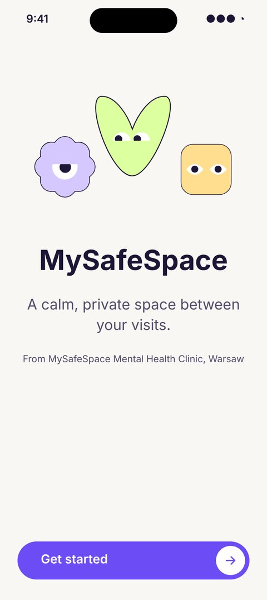<br><sub>Welcome</sub></td><td align="center">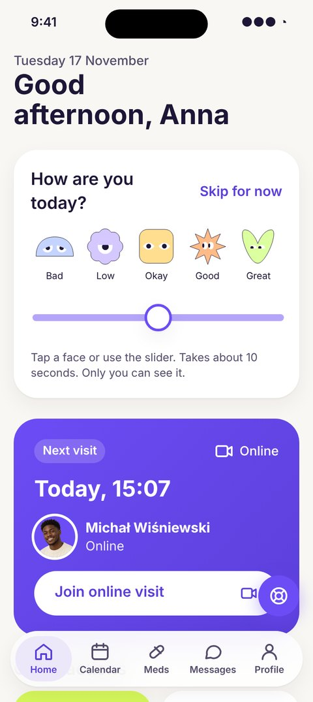<br><sub>Home: check-in + next visit</sub></td><td align="center">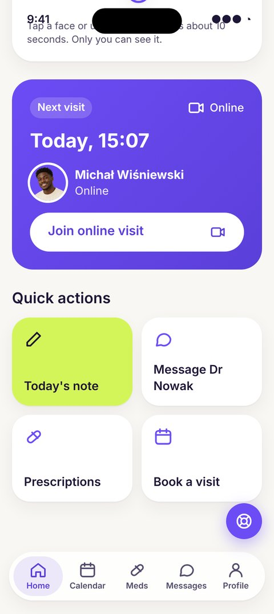<br><sub>Home: quick actions</sub></td><td align="center">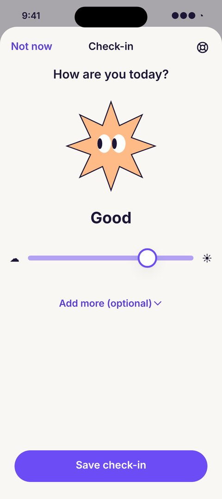<br><sub>Mood check-in</sub></td></tr>
<tr><td align="center">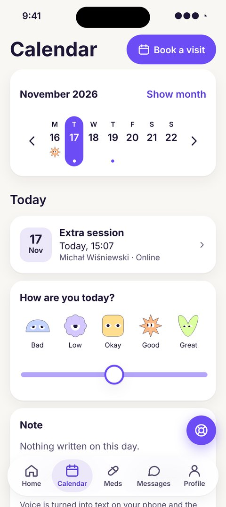<br><sub>Calendar: week</sub></td><td align="center">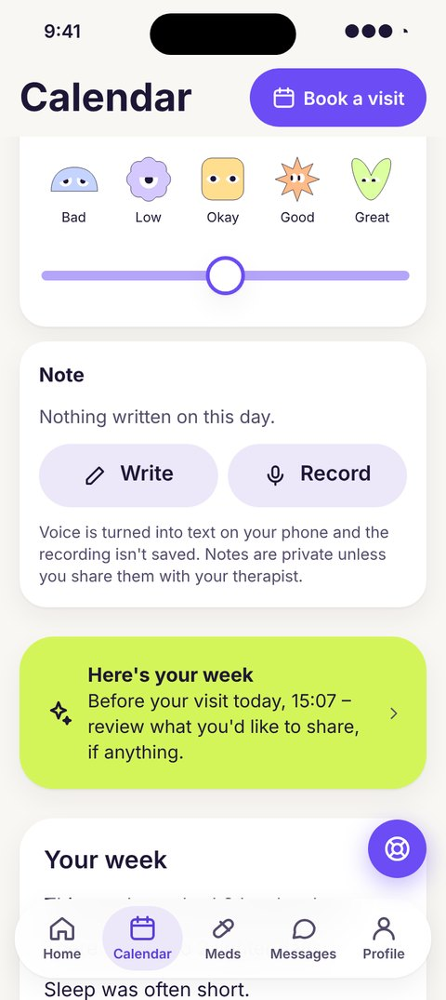<br><sub>Calendar: note & weekly summary</sub></td><td align="center">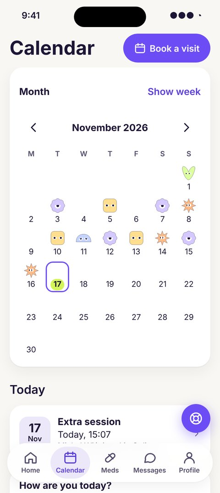<br><sub>Mood calendar</sub></td><td align="center">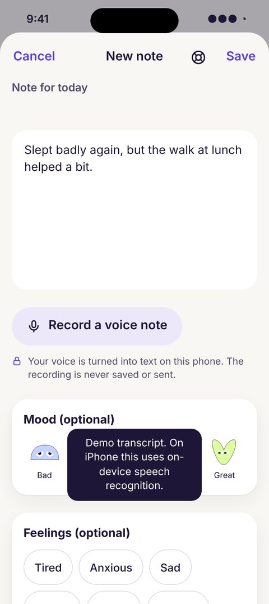<br><sub>New note with on-device dictation</sub></td></tr>
<tr><td align="center">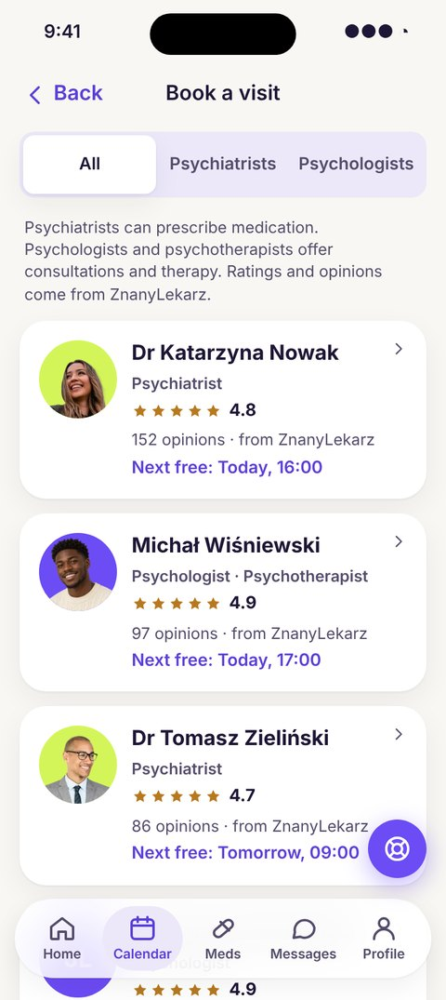<br><sub>Book a visit</sub></td><td align="center">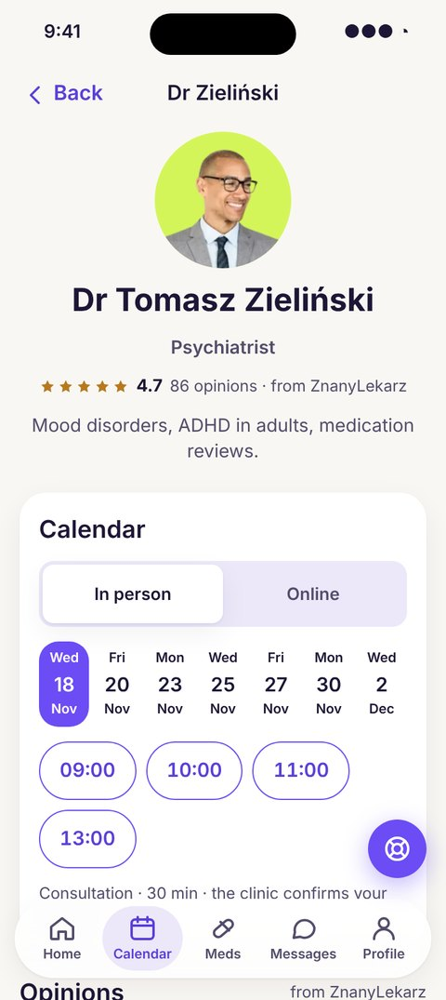<br><sub>Doctor profile & free times</sub></td><td align="center">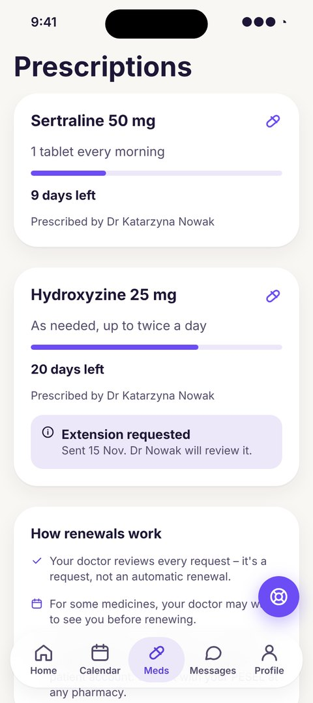<br><sub>Prescriptions</sub></td><td align="center">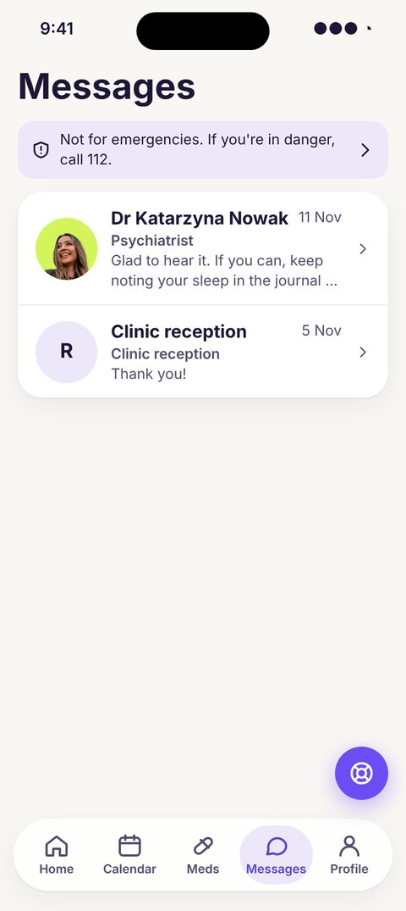<br><sub>Messages</sub></td></tr>
<tr><td align="center">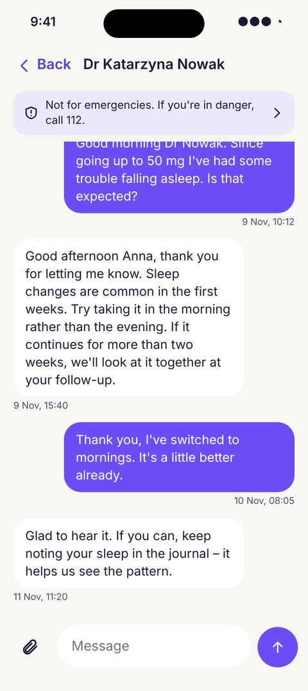<br><sub>Message thread with office hours</sub></td><td align="center">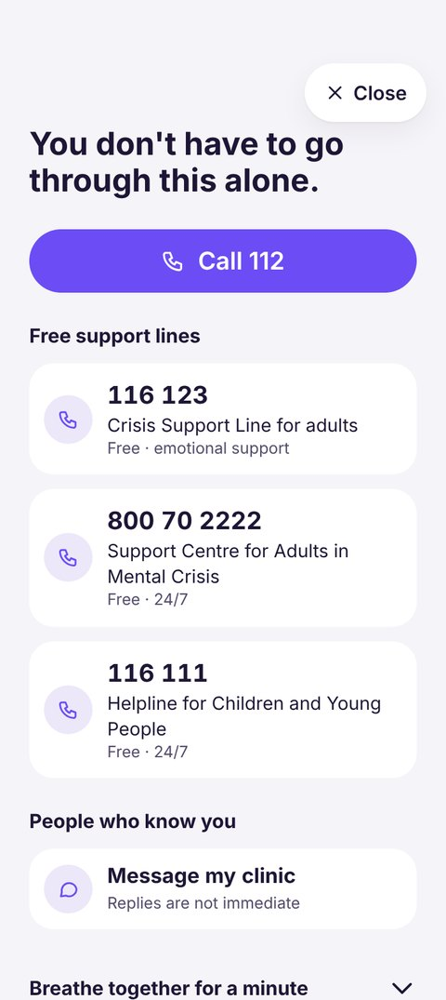<br><sub>Crisis support</sub></td></tr>
</table>

## Capturing more from Xcode

### Full shot list (light + dark, default + AX3)

Capture each screen in **light + dark**, at **default** and **AX3** (large accessibility) text. Name files `NN-screen-light-default.png` etc.

| # | Screen | How to reach it |
|---|---|---|
| 01 | Onboarding – welcome | Fresh install |
| 02 | Onboarding – safety note | Step 3 |
| 03 | Home (check-in card + next visit) | Home tab |
| 04 | Check-in (face slider, "Add more" open) | Tap a face on Home |
| 05 | Journal – entries | Journal tab |
| 06 | Entry editor with gentle support card | Type a negated phrase, e.g. "I would never hurt myself", and wait 2 s |
| 07 | Mood calendar | Journal → Mood calendar |
| 08 | Pre-visit summary – preview | Journal → Here's your week → Preview |
| 09 | Visits – week strip | Visits tab |
| 10 | Visit detail | Tap a visit |
| 11 | Online visit – location check | Home → Join online visit |
| 12 | Waiting room | Continue twice |
| 13 | Call | Enter visit |
| 14 | Prescriptions | Home → Prescriptions |
| 15 | Prescription approved (code) | Request extension → wait 3 s |
| 16 | Messages – thread | Messages → Dr Katarzyna Nowak |
| 17 | Crisis screen | "Need help now?" |
| 18 | Privacy centre | Profile → Privacy centre |
| 19 | Lock screen | Turn on the app lock, background the app for more than 1 min, return |
| 20 | Home Screen quick action | Long-press the app icon |

## Capture

```bash
# Clean status bar
xcrun simctl status_bar booted override --time 9:41 --batteryState charged --batteryLevel 100 --cellularBars 4
# Appearance & text size
xcrun simctl ui booted appearance dark          # or light
xcrun simctl ui booted content_size accessibility-extra-large   # AX3; "large" = default
# Screenshot
xcrun simctl io booted screenshot docs/screenshots/03-home-dark-ax3.png
```

SwiftUI `#Preview`s exist for every screen and component, so you can also export them from the Xcode canvas.
